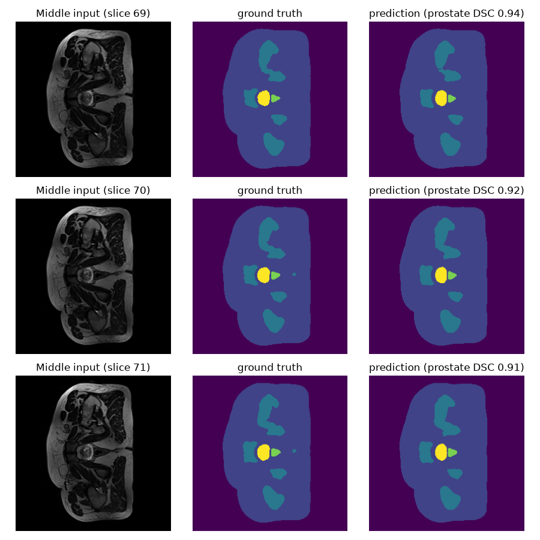
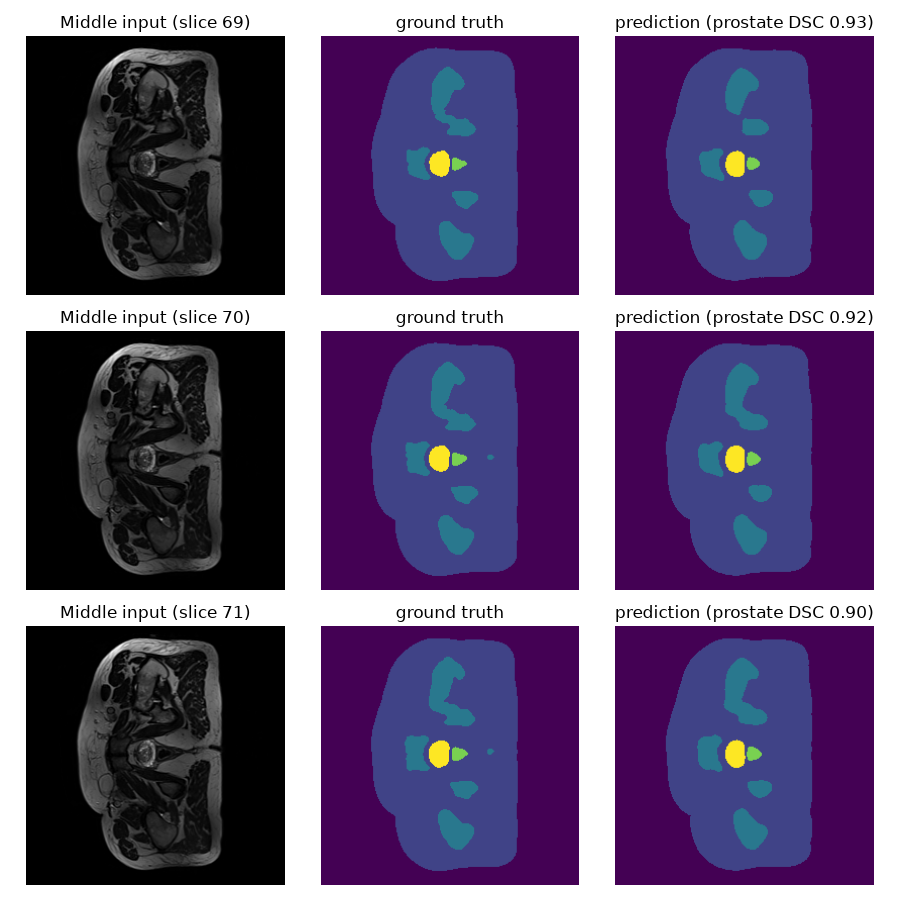
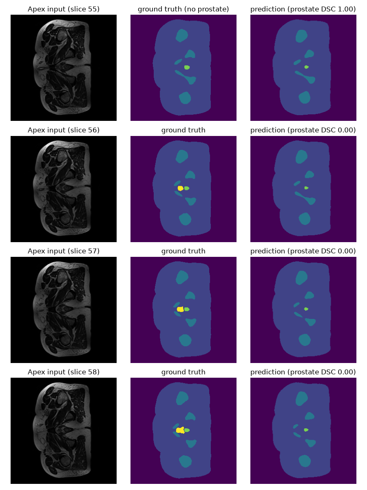
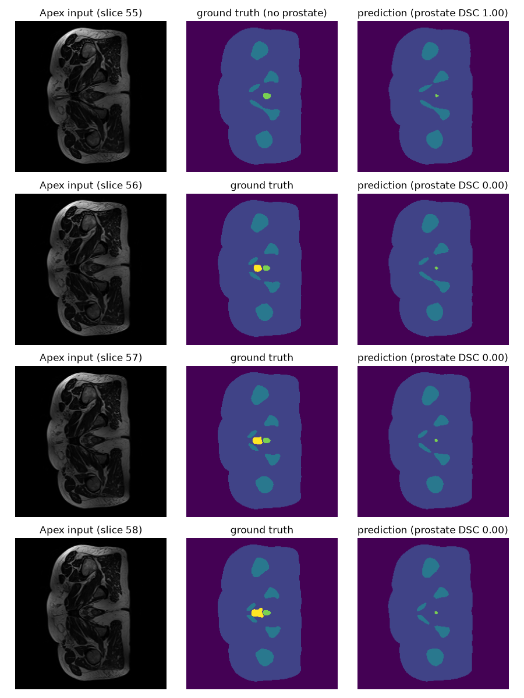
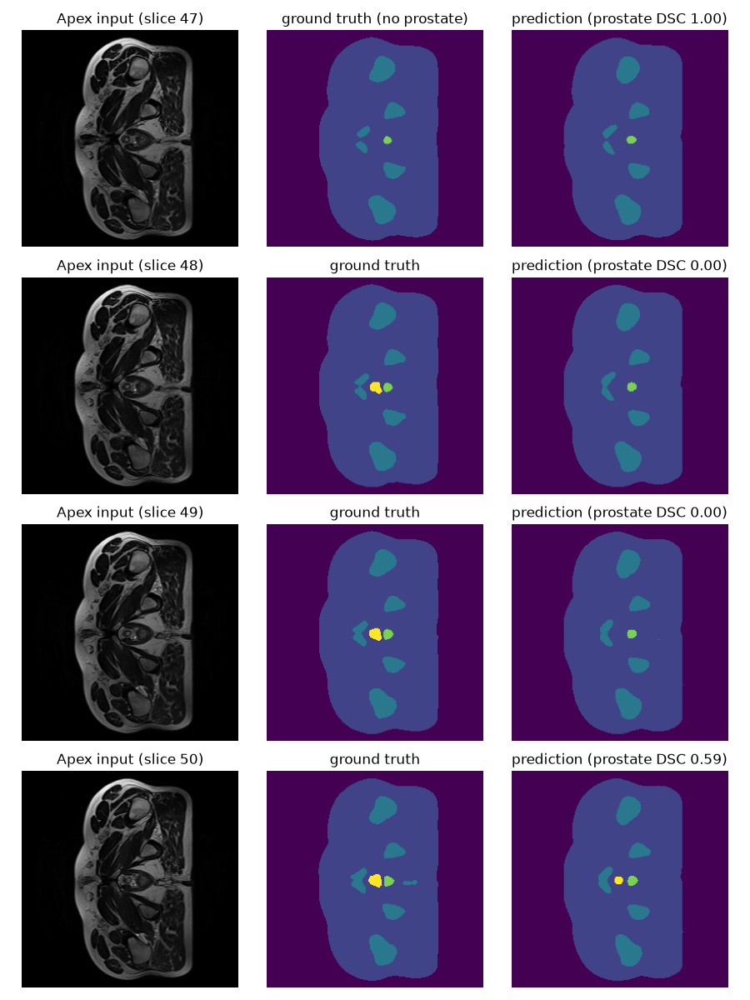
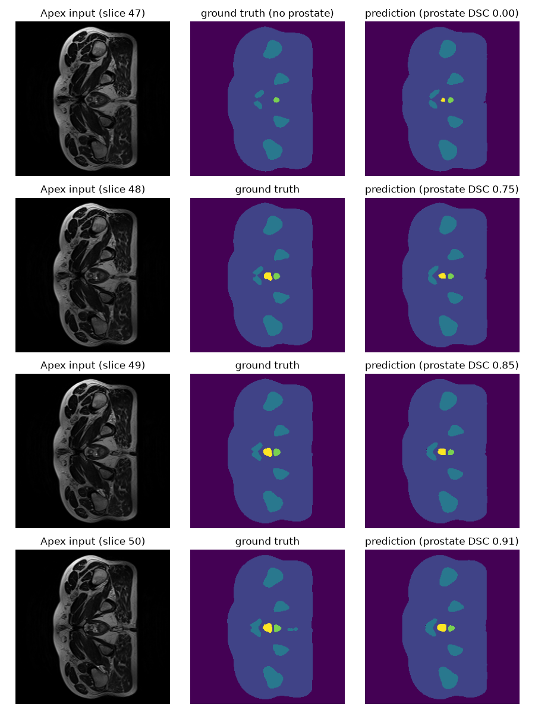
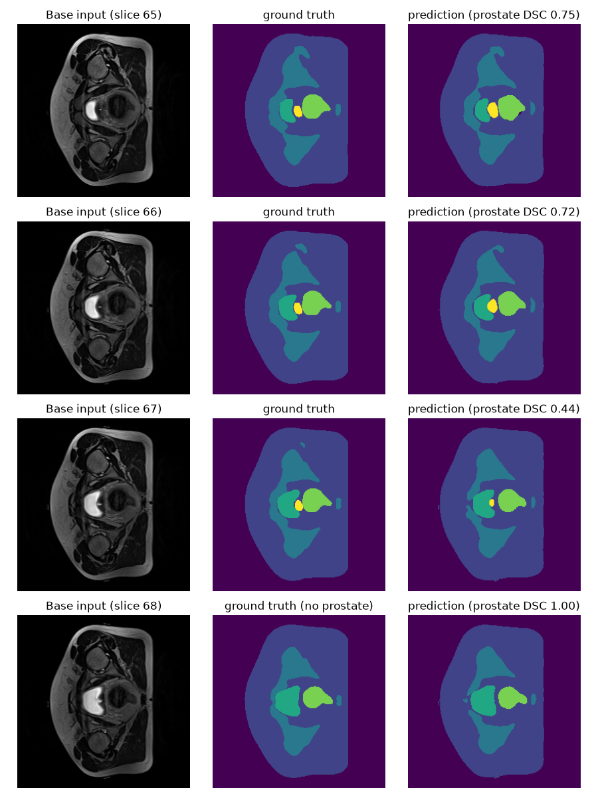
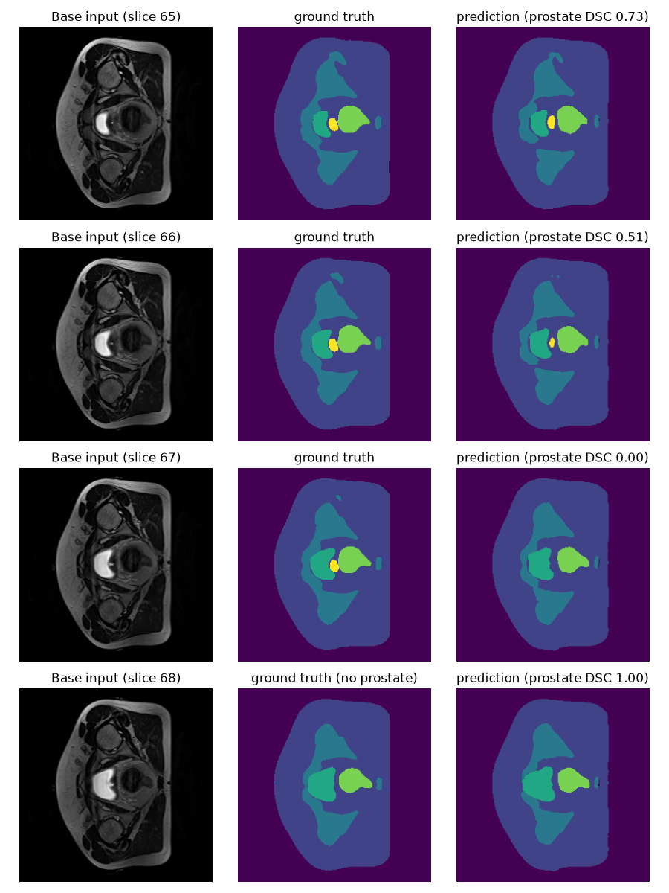
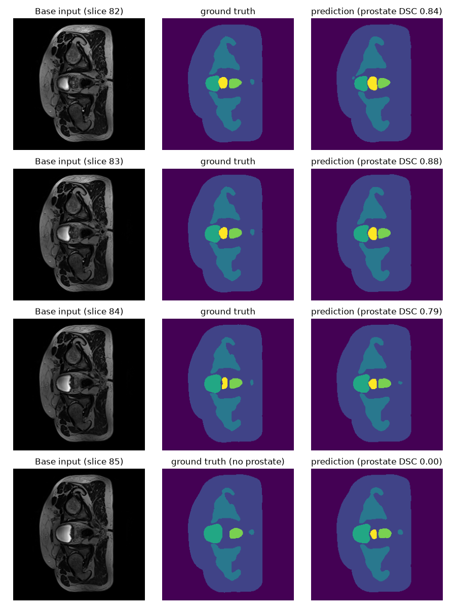
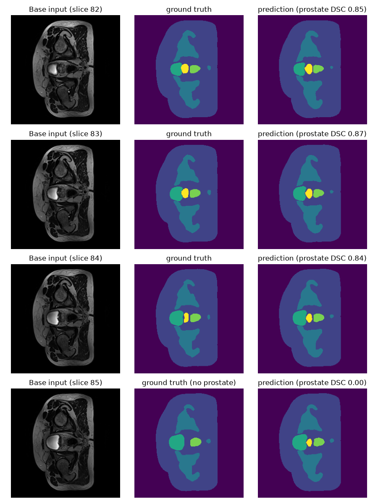

# Prostate MRI Segmentation using 3D Improved U-Net

**Author:** William Armstrong (48842613)

---

## Table of Contents

1. [Overview](#1-overview)
    - 1.1 [Background and Problem](#11-background-and-problem)
    - 1.2 [Addressing the Problem](#12-addressing-the-problem)
    - 1.3 [How It Works](#13-how-it-works)
    - 1.4 [2D U-Net Baseline](#14-2d-u-net-baseline)
2. [Feasibility Report](#2-feasibility-report)
    - 2.1 [User Need, Scope and Acceptance Criteria](#21-user-need-scope-and-acceptance-criteria)
    - 2.2 [Model Choice and Course Concepts](#22-model-choice-and-course-concepts)
    - 2.3 [Preliminary Feasibility Evidence](#23-preliminary-feasibility-evidence)
    - 2.4 [Risks, Budget and Fallback](#24-risks-budget-and-fallback)
3. [Run Instructions](#3-run-instructions)
    - 3.1 [Dependencies](#31-dependencies)
    - 3.2 [Setup and Reproducibility](#32-setup-and-reproducibility)
    - 3.3 [Usage](#33-usage)
4. [Inputs, Outputs and Plots](#4-inputs-outputs-and-plots)
    - 4.1 [Example Inputs and Outputs](#41-example-inputs-and-outputs)
    - 4.2 [Training Curves](#42-training-curves)
5. [Pre-Processing and Data Splits](#5-pre-processing-and-data-splits)
    - 5.1 [Volume Pairing and Shape Checks](#51-volume-pairing-and-shape-checks)
    - 5.2 [Normalisation and Label Encoding](#52-normalisation-and-label-encoding)
    - 5.3 [Training Augmentation](#53-training-augmentation)
    - 5.4 [Train, Validation and Test Split](#54-train-validation-and-test-split)
6. [Investigation of the Open Research Dilemma](#6-investigation-of-the-open-research-dilemma)
    - 6.1 [Quantitative Benchmarking of 3D Improved U-Net against 2D U-Net](#61-quantitative-benchmarking-of-3d-improved-u-net-against-2d-u-net)
    - 6.2 [Resource Profiling](#62-resource-profiling)
    - 6.3 [Qualitative Error Autopsies](#63-qualitative-error-autopsies)
    - 6.4 [Engineering Recommendation](#64-engineering-recommendation)
7. [Artificial Intelligence Usage Disclosure](#7-artificial-intelligence-usage-disclosure)
8. [References](#8-references)

---

## 1. Overview

### 1.1 Background and Problem

In Prostate Radiotherapy Planning (HipMRI), targeting a beam requires millimetre precision between the prostate and the surrounding critical organs (bladder, rectum, femoral heads). Under contouring risks tumour recurrence, while over contouring irradiates the surrounding organs causing severe damage. 

The HipMRI dataset contains 211 weekly volumes related to 38 patients, each volume has dimensions 256x256x128 and the labelled maps are segmented into six classes (background, body, bone, bladder, rectum, prostate). There are two main issues when trying to make models for this data. Firstly, as it is 3D data, if a 2D model attempts to learn it through slices it may result in jagged 3D boundaries and secondly the prostate is rather small, with it making up less than 2% of the overall 3D volume meaning that there is a massive class imbalance that needs to be looked at.

Therefore, this report aims to identify whether incorporating 3D volumetric continuity through the 3D Improved U-Net eliminates the hazardous boundary and slice-transition error when compared against a 2D U-Net baseline. 


### 1.2 Addressing the Problem

To address these issues, this project implemented a 3D Improved U-Net (Isensee et al, 2018). The 3D model takes the whole MRI volume as an input (not in slices) and outputs a six class voxel map. This allows the model to process whole volumes with 3D convolutions meaning that every prediction is informed by the slices above and below it. The model uses a multi-class dice loss using a soft dice that computes the dice per class and then averages, meaning that the prostate counts as much as the much larger background. This handles the class imbalance by embedding inside the loss function that every class should be taken into account equally. The model was analysed against a 2D U-Net baseline on the exact same patient level split, and data pre-processing in order to discover the effect 3D context has and whether it is capable of removing boundary and slice-transition errors or whether it just improves the easy central slices.

### 1.3 How It Works


*Figure 1: Model Architecture Flow (Blue: encoder, green: decoder, dashed: concatenated skip connections, numbers below each block: spatial size, Seg 3/2/1: 1x1x1 segmentation layers summed for deep supervision)*

The network shown in Figure 1 is a 3D Improved U-Net: an encoder that compresses the volume down to a small bottleneck, a decoder that builds it back up to full resolution, and skip connections between matching levels that carry across the fine spatial detail lost during the downsampling stage. The output is a six channel segmentation (one channel per class) at the full 256x256x128 resolution.

What makes it improved when compared to the standard U-Net are the following changes from Isensee et al. (2018):
- Pre-activation residual blocks in the encoder, which give gradients a shortcut path through the deeper network.
- Deep supervision, where segmentations from several decoder levels are combined into the final output.

The encoder (downsampling, blue) has five levels with 16, 32, 64, 128 and 256 channels. Each level starts with a 3x3x3 convolution with stride 2 (except level 1, which uses stride 1) to halve each spatial dimension, bringing 256x256x128 down to the 16x16x8 bottleneck. That output is then passed through a residual block of two 3x3x3 convolutions, each preceded by instance normalisation and leaky ReLU (slope = 0.01), with dropout (p=0.3) between them. The residual block's output is added back onto its input, and at levels 1 to 4 this sum is stored as that level's skip connection (dashed arrows). 

The decoder (upsampling, green) at each level upsamples by a factor of two using nearest neighbour, then uses a 3x3x3 convolution that halves the channels. The result is then concatenated with the matching skip connection, which doubles the channels again. At levels 4 to 2 a localisation module then merges the two (3x3x3 convolution that keeps channel count, followed by a 1x1x1 convolution that halves it).

Lastly, the deep supervision (Seg 3/2/1) is made up of three 1x1x1 convolutions which use the outputs of levels 3, 2 and 1 as six class segmentation maps. Each coarser map is trilinearly upsampled and added element wise to the next, so the final output combines the predictions that are made at three resolutions. The lower levels feed straight into the output, this means that the gradients from loss reach them directly rather than having to go through the rest of the decoder. 

The network outputs raw scores for every voxel. During training, a softmax turns these into class probabilities inside the dice loss and at prediction time, the argmax over the six channels gives each voxel its specific class (the one that is most likely, as deemed by the model).

### 1.4 2D U-Net Baseline

The standard 2D U-Net is implemented as taught in COMP3710. This consists of 5 levels with an encoder, bottleneck, decoder and skip connections between matching encoder and decoder levels. It takes input as slices of the whole volume (256x256x128), with each slice being 256x256x1. This is the exact comparison that is being evaluated as the 2D model is unable to look at the slices above and below it. It has the same overall shape as the 3D model, it uses max pooling for the downsampling blocks, and transposed convolutions for upsampling, and two 3x3 convolutions with a batch norm and ReLU at each level. It doesn't have any residual blocks or deep supervision.

It is trained through the exact same pipeline as the 3D model, with the same data split, pre-processing, augmentation, DSC, optimiser, and epochs. This ensures that the only difference is the fact that the model is 2D. It takes in and returns whole volumes like the 3D model, it just stacks the slices together to form the output shape (256x256x128) so that predict.py can evaluate them both in the same way.

---

## 2. Feasibility Report

### 2.1 User Need, Scope and Acceptance Criteria

The intended users of this segmentation model are imaging specialists. Their main needs are to speed up their work by moving from creating the anatomical contours to reviewing and adjusting the output of the model, while maintaining the safety of their patients. Therefore the purpose of the prototype is to be able to identify the different parts of the MRI and segment the images, ensuring to also reduce the under and over contouring of the prostate segmentation as that can be very dangerous to their patients.

To evaluate how well the model has addressed the problem some testable acceptance criteria have been made. For the 3D improved UNet to be worth it, it will further need to fix the issues around boundary and slice-transition errors and do it better than the 2D-UNet.

**Testable acceptance criteria:**

1. Sorensen-Dice similarity (DSC) greater than 0.7 in the prostate class on the test set
2. Base and Apex specific DSC greater than 0.7 in the prostate class on the test set
3. Intersection-over-Union (IoU) greater than 0.7 in the prostate class on the test set
4. Less than 5 hours of training time and less than 20GB of peak VRAM on an a100 GPU
5. Noticeable difference between 2D and 3D models: > 5% improvement in test results when looking at DSC in base and apex slices of the prostate

### 2.2 Model Choice and Course Concepts

The chosen dataset is HipMRI, focusing on Prostate Radiotherapy Planning. The chosen model architecture is the 3D Improved U-Net (Hard Difficulty). This model will be compared against a baseline 2D U-Net. This comparison will be used to weigh up if the larger computational expenses in the 3D improved U-Net will result in a better solution to the given problem. Testing whether it can improve upon the 2D U-Net's inability to take into account changes in 3D space (boundary and slice-transition errors) and whether this potential improvement is worth the increased compute required. The course concepts and literature support the choice of a 3D U-Net as U-Nets are used for segmenting data in high resolution using skip connections to avoid losing context from the downsampling process. Further literature supports giving the model 3D context over 2D slices as a way of allowing it to understand the way the data reacts across slices which is the exact problem that needs to be fixed.

### 2.3 Preliminary Feasibility Evidence

An initial data audit showed that there were a total of 211 scans, relating to 38 unique patients and each scan was a volume of shape 256x256x128 (there is one volume that has 256x256x144, but that gets clipped to a depth of 128). The data was split into `semantic_MRs` containing the raw MRI volumes and `semantic_labels_only` containing the source of truth for the segmentation by label. Further, it showed that slices 67-81 contained every class, moreover the prostate was present in a range from slices 45-81. A baseline smoke test on an A100 GPU for the 3D Improved U-Net showed that the data loaded correctly, split into train / validate / test, was able to run forward passes, train forward steps, evaluate and save checkpoints of the model. Further this smoke test allowed for measured resource estimation, with the dataset setup time taking 74 seconds, and each epoch taking approximately 35 seconds, the peak VRAM was also measured to be 21.46 GB. Estimating for approximately 50 epochs of training it would take approximately 30 minutes to train.

### 2.4 Risks, Budget and Fallback

The key technical risks of this task are the memorisation of data (overfitting), lack of 3D data, cross contamination of patients data (not keeping the splits separate), high memory consumption, and accurate validation techniques.

The computing budget consists of usage of 100 tokens ($15) for an A100 GPU on Google Colab at an approximate usage of 6 tokens per hour allows for a maximum of 16 hours of use. This accounts for the training for the baseline, smoke test and full runs. This should be plenty of compute power and time to account for estimated resource consumption.

The Next planned experiment is a full training run against the data with a larger number of Epochs, then testing the accuracy of the boundaries and slice transitions in comparison to the 2D U-Net. If the 3D Improved U-Net fails to train, a workable fallback would either be the 3D U-Net or the baseline 2D U-Net.

---

## 3. Run Instructions

### 3.1 Dependencies

Ensure that the following dependencies are installed in the environment that this project is being run. Further for training it requires about 22GB of VRAM (A100 class GPU) or if that is unavailable, reduce the batch size to 1 so that it trains slower but doesn't load in as much at once (this has not been tested). Prediction requires about 8GB of VRAM or it can be run on the CPU which would be much slower.

- Python 3.12.3
- torch 2.14.1 (`pip install torch==2.14.1`)
- numpy 2.5.4 (`pip install numpy==2.5.4`)
- nibabel 5.4.2 (`pip install nibabel==5.4.2`)
- matplotlib 3.11.2 (`pip install matplotlib==3.11.2`)
- tqdm 4.70.1 (`pip install tqdm==4.70.1`)

### 3.2 Setup and Reproducibility

Set the dataset root path in `train.py` and `predict.py` to the path containing the `semantic_MRs_anon` and `semantic_labels_anon` folders. Further it is optional to adjust the hyperparameters in `train.py`. It is important not to adjust the random seed in `dataset.py`, as this would adjust the train / validate / test split and make it so that the results cannot be compared as directly to the results in this report. Further although the hyperparameters are the same and the data split is the same it does not necessarily mean that the results will be repeated exactly due to the fact that mixed precision is non-deterministic and the random seed used for data augmentation differs each run.

### 3.3 Usage

An example usage would be:
```
cd recognition/HipMRI
python train.py # 3D Model: outputs unet3d_hipmri.pt and unet3d_plot_data.json
python UNet_2D.py # 2D Model: outputs unet_2d_hipmri.pt and unet_2d_plot_data.json
# move the .pt and .json files into 3D_Model/ and 2D_Unet_output/
python predict.py # test metrics and images in folder/predictions/ run for is_3d true
python predict.py # test metrics and images in folder/predictions/ run for is_3d false
python plot_curves.py # loss and dice curves run for is_3d true
python plot_curves.py # loss and dice curves run for is_3d false
```

---

## 4. Inputs, Outputs and Plots

There are two different areas in which inputs and outputs are taken. In the training (train.py) the inputs are the images and labels, and the outputs are the weights (.pt), the curve data (.json) and various updates printed to the terminal (time, epoch, DSC, VRAM). In the usage of the model (predict.py) the inputs are the images and the ground truth labels and the outputs are the metrics, images showing input, ground truth, and model segmentation output and overall stats printed to the terminal (inference time, DSC, IoU).

### 4.1 Example Inputs and Outputs



*Figure 2: 3D Improved U-Net on test Case 008 (Week 0), middle prostate slices 69–71. Columns: input MRI, ground truth, prediction. Colours: dark purple: background, blue purple: body, teal: bone, green: bladder, light green: rectum, yellow: prostate.*



*Figure 3: 2D U-Net baseline on the same case and slices as Figure 2. Columns and colours as in Figure 2.*

Figures 2 and 3 show both the 3D Model and 2D model input, expected output and output. The input to the model is a 1 channel volume which can be seen as the images on the left. The output / prediction of the model can be seen on the right and is a segmentation of the image with six classes. The middle image shows the expected output, or the ground truth, what the prediction should be compared against. Predict.py generates 9 of these figures for each model, looking at 3 different volumes. On each volume it looks at 3 different types of slices, the middle, apex and base. For the middle it shows the three middle slices. For the apex and base it shows one slice outside the prostate and three inside. This is done to be able to see how the model reacts on a wider range around the predicted fail cases (apex and base).

### 4.2 Training Curves


*Figure 4: 3D Improved U-Net: validation Dice per class per epoch*


*Figure 5: 2D U-Net: validation Dice per class per epoch*


*Figure 6: 3D Improved U-Net: training and validation loss per epoch*


*Figure 7: 2D U-Net: training and validation loss per epoch*

As can be seen by the 2D and 3D models Dice and Loss plots in Figures 4 to 7 both models DSC quickly rose over the first 20 epochs and then levelled off for the rest of the training. It can also be seen that the prostate is the lowest and the noisiest class while still constantly slowly increasing.

It can also be seen that the training and validation loss graphs for both follow the same pattern, with the validation loss trailing closely behind the training loss. By around epoch 40 the validation loss is only a little bit larger the training loss meaning that there was only a minimal amount of overfitting that did not increase much over the 100 epochs. Note that the validation loss starts under the training loss because the dropout and augmentation of the data only happens during the training. The 2D model's loss starts higher (0.8 vs 0.6) and takes around 10 epochs to catch up and its final train/validation gap is slightly larger meaning that it likely overfitted to the data a bit more, although this level of overfitting is normal and wouldn't heavily affect the models performance.

These plots also determine which model gets saved, the model with the best minimum class validation score (the model with the best worst class validation score) is the model that gets saved and used.

---

## 5. Pre-Processing and Data Splits

Pre-processing and data augmentation were used in order to avoid data memorisation, data leaking and ensure that the model was good generally, not just on the training set.

### 5.1 Volume Pairing and Shape Checks

Firstly, each MRI is paired up with its corresponding label using the `get_pairs` function, this is important as a mismatched pair would evaluate the model on the wrong thing. Another check was done to the data showing that there was two different types of shapes 256x256x128 and 256x256x144, only one of the volumes had a depth of 144 and `load_data_3d` just uses the first shape it sees and either clips anything above that depth and zero pads anything below. As only one volume had a depth of 144 and the rest were 128 and 128 was the one that `load_data_3d` uses it was deemed that it was worth to keep the depth of 144 data as using it and having more data is better than not using it and having less. Further, the data audit showed that for one volume the prostate lived in slices 45-81, so the clipped slices shouldn't contain any prostate and the model should still be able to work on it as it is valid data.

### 5.2 Normalisation and Label Encoding

The data was normalised when it was loaded. Firstly there was a z-score normalisation (`normImage=True`) done on each volume ((x - mean) / std) so that every volume has a mean of 0 and a standard deviation of 1. This is useful as the intensities of an MRI have no standardised intensity values, so the same tissue can have a different value on a different scan so the normalisation fixes this by making those fluctuations on a scale that is similar across the MRIs (Isensee et al. 2018).

The labels are one hot encoded inside the loss, they are kept as uint8 classes (0-5) and the `F.one_hot` inside `DiceLoss` turns them into 6 channels. This is useful as storing 6 channels per voxel for every one of the volumes would use six times the memory, it is also important so that a weight is not arbitrarily affected by class having a higher integer value further the DSC needs the one value per class to compute a score per class.

### 5.3 Training Augmentation

Now, in the training set only, the data was augmented further. This was done as there are only 26 training patients and if the data was not augmented it was likely that the model would overfit and memorise the data, performing poorly on any data it had not seen while performing great in training. Note that the test and validation data is never augmented so that when the model runs on them it reflects real scans output.

The augmentation happened independently to each batch, this means that each epoch would see a differently augmented version of each volume. Each augmentation had a 50% chance of happening, so that the amount of limited data could be extended and be more 'unique' data. The following augmentation techniques were performed on the images and labels of the training (needs to apply to both or else if the image is rotated then the label should be as well or it won't have the correct loss). Isensee et al, used random rotations, random scaling, random elastic deformations, gamma correction augmentation and mirroring. From this list, the chosen data augmentations were random rotations, random scaling, and gamma correction was replaced with a linear transformation.

The volumes were randomly mirrored left to right (swapping the patients left and right sides). When looking at the images in Figure 2 it can be seen that the image is roughly symmetric from left to right, so a mirrored scan would still look lke a real patient. Note that the figures in this README show each slice rotated by 90 degrees, the patients left to right runs up and down the page, while the front to back runs across it (the bladder is anatomically at the front of the body, but on the image it is to the left, and the rectum is at the back of the body, and it is on the right of the image). The volumes were never mirrored front to back as this would swap the bladder and the rectum, placing the rectum in front of the prostate, that would be impossible anatomically and would teach the model to learn from the wrong thing.

There were axial rotations of up to 15 degrees positively and negatively and also zooming in or out of up to 10%. This is useful as it simulates the small differences in a patient's positioning and body or organ size. A nearest neighbour resample is then used so every voxel stays belonging to only one class.

The border is padded in a way that the rotated corners copy the edge values instead of filling with 0 as when the data has been normalised a value of 0 is likely to be something like tissue and may not be background.

If the augmentation were to use gamma which is non-linear (x'=x^y) as there are normalised values, there are negative values and the data would need to be rescaled to [0,1] first. As such for ease, a random linear transformation is applied (x'=ax+b) to the image. This is applied only to the image to affect the brightness and contrast of the image so that the model relies on the shape and relative contrast and brightness rather than the exact value to reduce overfitting.

### 5.4 Train, Validation and Test Split

To ensure that there was no data leaking there was a patient level split, not just a split based on week, volume, or slice. `split_pairs` groups by `Case_AAA` so that all of a patient's weekly scans are in one place. This is crucial as with 211 volumes and 38 patients each with about 5 scans a random split based on volume would have the model training on nearly identical data to what it is being validated and tested against. This would artificially increase the validation and test scores and overfit to the data given without much generalisability.

Using this split based on patient, there was about 70% in the training set, 15% in the validation and 15% in the test. This corresponded to 26 training patients (143 volumes), 6 test patients (27 volumes), and 6 validation patients (41 volumes). The idea was to try and use as many patients as possible to train the model. Use the validation patients as a way to save the best model generated (best minimum class Dice Similarity Coefficient). Test is completely separated and only used in `predict.py`. Further a fixed seed is used for both the 2D baseline and 3D model so that they are tested on the same splits and so that the randomisation removes selection bias that can be generated from hand picking patients and volumes for each set. With only 6 test patients (27 volumes) the results for the test could majorly shift with a different split.

---

## 6. Investigation of the Open Research Dilemma

The open research question was to understand whether incorporating 3D volumetric continuity can eliminate boundary and slice-transition errors compared to a 2D baseline.

### 6.1 Quantitative Benchmarking of 3D Improved U-Net against 2D U-Net

Both models are evaluated on the same 6 patients with 27 volumes. The table below shows the 2D and 3D models scored against DSC and IoU on every class. The difference is calculated as the 3D result - 2D result.

| Class | 2D DSC | 3D DSC | Difference | 2D IoU | 3D IoU | Difference |
|---|---|---|---|---|---|---|
| Background | 0.9953 | 0.9978 | +0.0025 | 0.9906 | 0.9957 | +0.0051 |
| Body | 0.9838 | 0.9880 | +0.0042 | 0.9682 | 0.9763 | +0.0081 |
| Bone | 0.9242 | 0.9267 | +0.0025 | 0.8592 | 0.8635 | +0.0043 |
| Bladder | 0.9487 | 0.9591 | +0.0104 | 0.9032 | 0.9216 | +0.0184 |
| Rectum | 0.8561 | 0.8821 | +0.0260 | 0.7522 | 0.7916 | +0.0394 |
| Prostate | 0.8592 | 0.8602 | +0.0010 | 0.7547 | 0.7562 | +0.0015 |
| **Mean** | 0.9279 | 0.9356 | +0.0077 | 0.8714 | 0.8842 | +0.0128 |
| **Min class** | 0.8561 (Rectum) | 0.8602 (Prostate) | +0.0041 | | | |

This table shows just the prostate, specifically focusing on the last 5 slices on the apex and on the base as determined by what the label says should be the lowest and the highest slice. Note that there is a limitation when scoring in this manner, it does not penalise the model for making a claim that there is a prostate outside of the areas that the label states there is a prostate (this is only penalised in the whole section).

| Region | 2D DSC | 3D DSC | Difference | 2D IoU | 3D IoU | Difference |
|---|---|---|---|---|---|---|
| Whole | 0.8592 | 0.8602 | +0.0010 | 0.7547 | 0.7562 | +0.0015 |
| Apex | 0.7854 | 0.8418 | +0.0564 | 0.6659 | 0.7455 | +0.0796 |
| Base | 0.7718 | 0.7630 | -0.0088 | 0.6390 | 0.6275 | -0.0115 |

Looking at both tables, it can be seen that the 3D model is on the whole achieving better results in every section when compared with the 2D model. This has the exception of the base slices where in the prostate it scores just below the 2D model (-0.0088 DSC, -0.0115 IoU). The 3D model makes its biggest gain against the 2D model at the apex looking at the prostate (+0.0564 DSC, 0.0796 IoU).

Globally the 3D model achieves a prostate Dice Similarity Coefficient (DSC) of 0.86 and an Intersection over Union (IoU) of 0.7562 which exceeds the 0.7 target. However, this score masks a weakness over the five most superior (base) slices obtaining a DSC of 0.7629 and an IoU of 0.6275.

### 6.2 Resource Profiling

| Metric | 2D U-Net | 3D Improved U-Net | Difference |
|---|---|---|---|
| Parameters | 1,942,374 | 9,464,674 | +7,522,300 |
| Peak GPU VRAM (inference) | 7,088 MB | 8,085 MB | +997 MB |
| Peak GPU VRAM (training) | 20.54 GB | 21.47 GB | +0.93 GB |
| Inference time per case | 0.055 s | 0.127 s | +0.072 s |
| Training time (100 epochs) | 55 min | 58 min | +3 min |

The resource consumption of the 2D model and the 3D model are fairly comparable. The specification warned that the 3D model may need 5-10x the GPU memory and training time, although here it doesnt, the training only requires about 1GB more VRAM and 3 more minutes. The main difference is 5x the parameters, the inference is 2.3x slower, but the 0.13 seconds per volume is insignificant considering how much time it would take someone to do the segmentation clinically.

### 6.3 Qualitative Error Autopsies

Four representative failure cases from the test set are examined below, two at the apex and two at the base. Each figure shows the same slices for both models, with the prostate Dice for each slice in the prediction title. Columns and colours are as in Figure 2.

#### Case 1: Case 008 apex, missed by both models

| 2D U-Net | 3D Improved U-Net |
|---|---|
|  |  |

*Figure 8: Case 008 apex, slices 55–58 (slice 55 has no prostate in the ground truth).*

Looking at figure 8, both models miss the first three prostate slices completely, with a DSC of 0 on each. The likely cause is the fact that the prostate at the apex is very small and has almost no contrast with the surrounding tissue in the input MRI, so there is little signal for either model to detect. Further the 3D models extra context was not enough when the signal was as faint as it is. This is very clear under contouring at the apex and would leave this part of the prostate untreated, which would risk the tumour recurring. Neither model is better in this scenario.

#### Case 2: Case 009 apex, 3D model succeeds where 2D fails

| 2D U-Net | 3D Improved U-Net |
|---|---|
|  |  |

*Figure 9: Case 009 apex, slices 47–50 (slice 47 has no prostate in the ground truth).*

The 3D model finds prostate on all slices, it is present from the first slice and it holds onto it until the end (DSC 0.00, 0.75, 0.85, 0.91 on slices 47-50). The 2D model misses the slices 48 and 49 entirely and only reaches 0.59 on slice 50. Notably the 3D model predicts a small amount of prostate on slice 47 where the ground truth shows none. The likely cause for this is the fact that the 3D model can follow the prostate down from the slices above where they are larger and clearer which likely led to the overshoot in slice 47, whereas the 2D model only sees each individual slice so when it is faint it will be unclear. This is the most clear example of the apex improvement measured in section 6.1. Note that the 3D model here is much closer to being usable although the one slice overshoot on slice 47 would still need a specialist to get rid of it.

#### Case 3: Case 026 base, 2D model succeeds where 3D fails

| 2D U-Net | 3D Improved U-Net |
|---|---|
|  |  |

*Figure 10: Case 026 base, slices 65–68 (slice 68 has no prostate in the ground truth).*

In figure 10, the 3D model under contours slice 66 and misses slice 67 completely, the 2D model scores 0.72 and 0.44 on the same slices. The 2D model is clearly better here and the under contouring at the base by the 3D model leaves a risk of tumour being untreated at the point where prostate meets bladder. The likely cause is that the base of the prostate becomes a thin sliver pressed against the bladder and the 3D model smooths these away using the context from slices around them, while the 2D model is able to judge each slice on its own.

#### Case 4: Case 008 base, both models extend past the prostate

| 2D U-Net | 3D Improved U-Net |
|---|---|
|  |  |

*Figure 11: Case 008 base, slices 82–85 (slice 85 has no prostate in the ground truth).*

In figure 11 both of the models predict that the prostate is in slice 85 which is past where the ground truth says it ends. Neither model is better in this scenario and the likely cause is that the prostate and bladder in this input image look similar at this boundary and the prostate doesnt look like it ends sharply between slices. This type of over contouring requires careful consideration as it puts organs at risk and would need to be removed by a specialist.

#### Summary

Both models segment the middle of the prostate well. Their failures are concentrated in the first and last few slices. The 3D model seems to overshoot more often, when it finds the image it predicts it well but will tend to overshoot. The 2D model does not suffer from this failure case as it has no previous context, although this means that sometimes it will not find the prostate at all for multiple slices. This is an important difference and shows the different failure case of the two different models.

### 6.4 Engineering Recommendation

The table below checks both models against the acceptance criteria set in the [feasibility report](#21-user-need-scope-and-acceptance-criteria).

| Criterion | 3D Improved U-Net | 2D U-Net | Result |
|---|---|---|---|
| 1. Prostate DSC > 0.7 | 0.8602 | 0.8592 | Pass (both) |
| 2. Apex and base prostate DSC > 0.7 | Apex 0.8418, Base 0.7630 | Apex 0.7854, Base 0.7718 | Pass (both) |
| 3. Prostate IoU > 0.7 | 0.7562 | 0.7547 | Pass (both) |
| 4. Training time < 5 hours and peak VRAM < 20 GB | 58 min, 21.47 GB | 55 min, 20.54 GB | Time passes, VRAM fails (both) |
| 5. > 5% DSC improvement of 3D over 2D at the apex and base | Apex +7.2%, Base −1.1% |  | Partial (apex only) |

Note that criteria 5 uses relative improvement, for example for the apex (0.8418 − 0.7854) / 0.7854 = +7.2% improvement.

Overall, the 3D Improved U-Net improves upon the 2D U-Net baseline in nearly all aspects of quality and only has slightly worse resource consumption. Looking at the table above shows that both models pass criteria 1, 2, 3, and the time constraint in criteria 4. They both fail the VRAM consumption in training by similar amounts although the 3D model is only about 1.5 GB over and it still fits within a single A100 GPU so it is deemed insignificant. Further it is important to note that looking at criteria 5, although there is a 1.1% decrease in performance in the base slices, there is a 7.2% increase in performance in the apex slices. The added 3D context has shown to reduce the boundary errors at the apex of the prostate, although it has shown it has not helped on the base. The recommendation that would be given is to make use of the new 3D model to speed up the segmentation of MRIs but to pay more attention to the areas it is known to be lacking, specifically the base slices and look out for the over countouring when it hangs onto prostate that is not there.

---

## 7. Artificial Intelligence Usage Disclosure

**Tools used:** Claude (Opus 5.5)

**Specific tasks:**

- Implementing functions that were scaffolded for it
- Researching and explaining different techniques to me
- Used it to check over what I had written in the README and tell me where it was weak / could be improved (flimsy explanations, lack of context, lack of analysis)

**How I audited the AI:**

- I would not allow the AI to automatically input any code, instead writing it in myself understanding each line before moving onto the next. Whenever I didn't understand what it had done, I would get it to confirm the meaning behind the line.
- I made sure to test that the functions worked together in a smoke test before doing a full long run.
- When it suggested a reference, I would go to said reference and find the place where it said the thing being referenced.

---

## 8. References

1. F. Isensee, P. Kickingereder, W. Wick, M. Bendszus, and K. H. Maier-Hein, "Brain tumor segmentation and radiomics survival prediction: Contribution to the BRATS 2017 challenge," in *Brainlesion: Glioma, Multiple Sclerosis, Stroke and TBI Models*, 2018, pp. 287–297.
