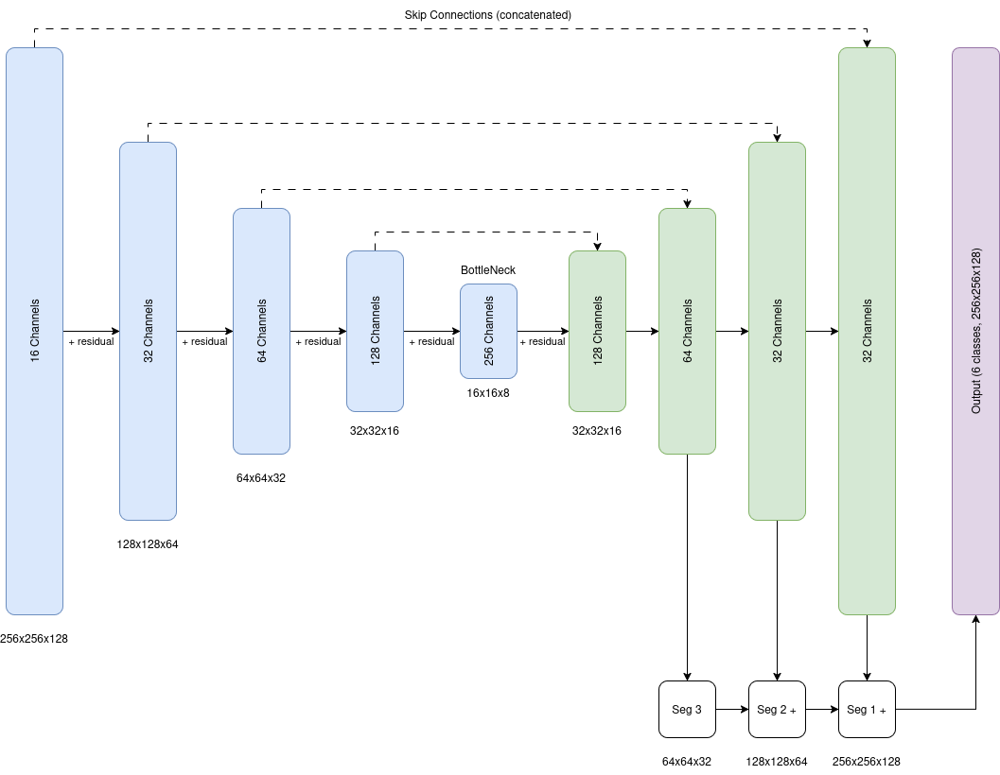
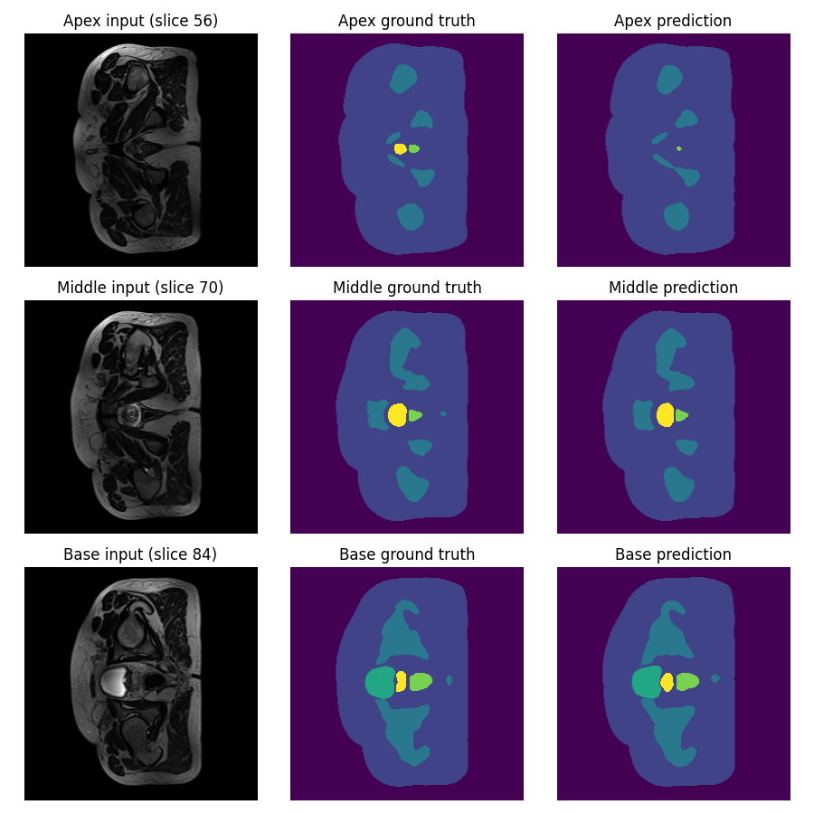
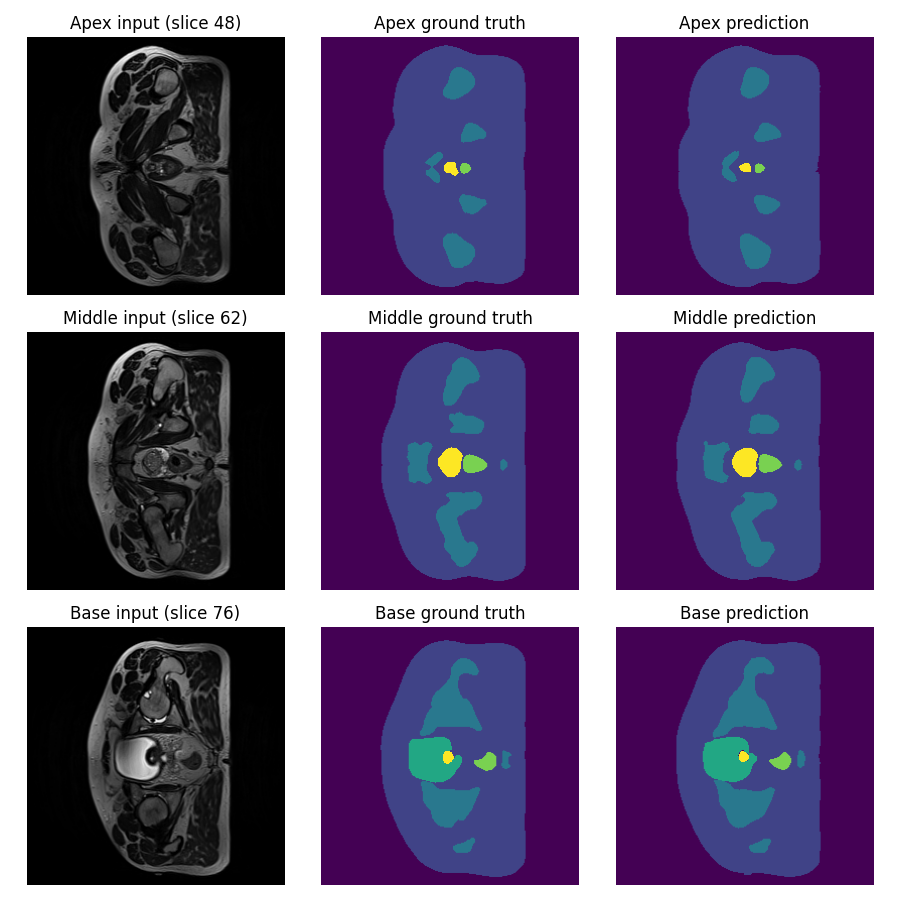
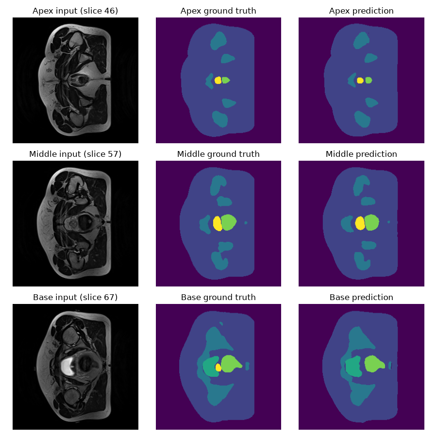
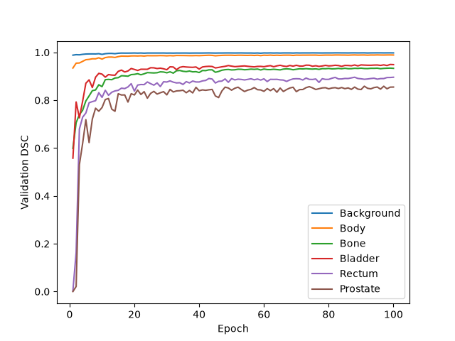
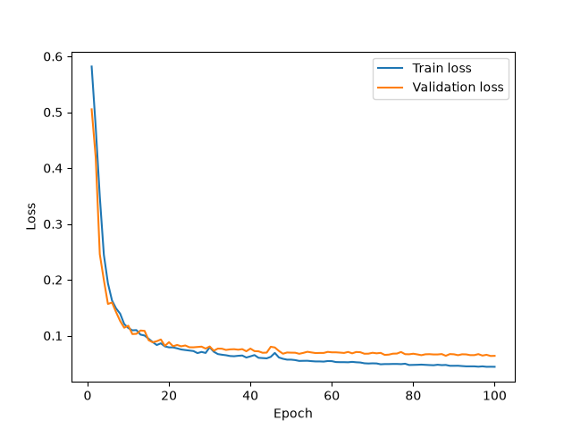
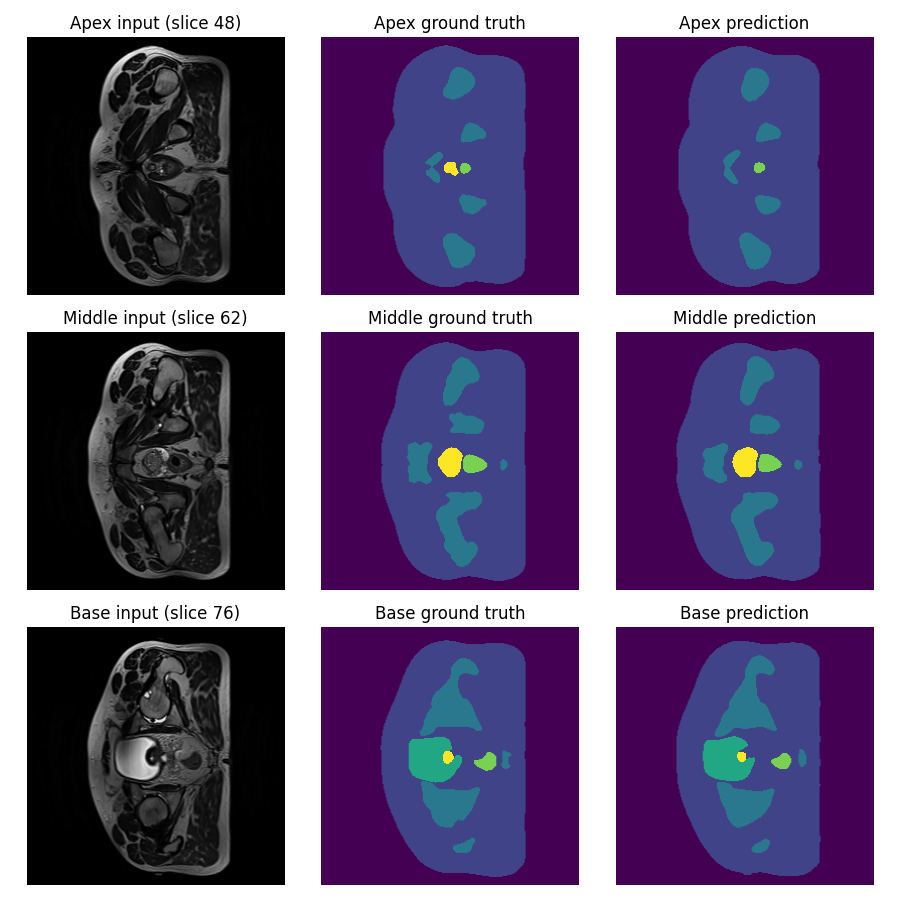
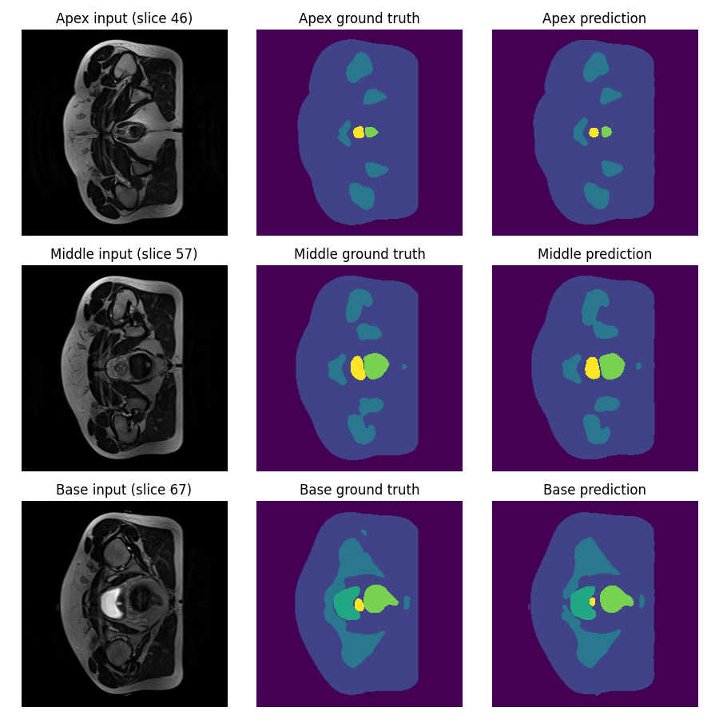
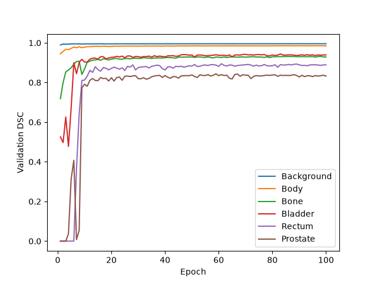
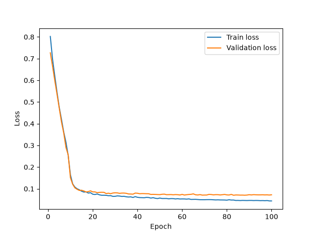

# Prostate MRI Segmentation using 3D Improved U-Net

**Author:** William Armstrong (48842613)

---

## Table of Contents

1. [Overview](#1-overview)
    - 1.1 [Background and Problem](#11-background-and-problem)
    - 1.2 [Addressing the Problem](#12-addressing-the-problem)
    - 1.3 [How It Works](#13-how-it-works)
2. [Feasibility Report](#2-feasibility-report)
    - 2.1 [User Need, Scope and Acceptance Criteria](#21-user-need-scope-and-acceptance-criteria)
    - 2.2 [Model Choice and Course Concepts](#22-model-choice-and-course-concepts)
    - 2.3 [Preliminary Feasibility Evidence](#23-preliminary-feasibility-evidence)
    - 2.4 [Risks, Budget and Fallback](#24-risks-budget-and-fallback)
3. [Run Instructions](#3-run-instructions)
    - 3.1 [Dependencies](#31-dependencies)
    - 3.2 [Setup and Reproducibility](#32-setup-and-reproducibility)
4. [Inputs, Outputs and Plots](#4-inputs-outputs-and-plots)
    - 4.1 [3D Improved U-Net](#41-3d-improved-u-net)
    - 4.2 [2D U-Net Baseline](#42-2d-u-net-baseline)
5. [Pre-Processing and Data Splits](#5-pre-processing-and-data-splits)
    - 5.1 [Volume Pairing and Shape Checks](#51-volume-pairing-and-shape-checks)
    - 5.2 [Normalisation and Label Encoding](#52-normalisation-and-label-encoding)
    - 5.3 [Training Augmentation](#53-training-augmentation)
    - 5.4 [Train, Validation and Test Split](#54-train-validation-and-test-split)
6. [Investigation of the Open Research Dilemma](#6-investigation-of-the-open-research-dilemma)
    - 6.1 [Quantitative Benchmarking of 3D Improved U-Net against 2D U-Net](#61-quantitative-benchmarking-of-3d-improved-u-net-against-2d-u-net)
    - 6.2 [Resource Profiling](#62-resource-profiling)
    - 6.3 [Qualitative Error Autopsies](#63-qualitative-error-autopsies)
    - 6.4 [Engineering Recommendation](#64-engineering-recommendation)
7. [Artificial Intelligence Usage Disclosure](#7-artificial-intelligence-usage-disclosure)
8. [References](#8-references)

---

## 1. Overview

### 1.1 Background and Problem

In Prostate Radiotherapy Planning (HipMRI), targeting a beam requires millimeter precision between the prostate and the surrounding critical organs (bladder, rectum, femoral heads). Under contouring risks tumour recurrence, while over contouring irradiates the surrounding organs causing severe damage. 

The HipMRI dataset contains 211 weekly volumes related to 38 patients, each volume has dimensions 256x256x128 and the labeled maps are segmented into six classes (background, body, bone, bladder, rectum, prostate). There are two main issues when trying to make models for this data. Firstly, as it is 3D data, if a 2D model attempts to learn it through slices it may result in jagged 3D boundaries and secondly the prostate is rather small, with it making up less than 2% of the overall 3D volume meaning that there is a massive class imbalance that needs to be looked at.

Therefore, this report aims to identify whether incorporating 3D volumetric continuity through the 3D Improved U-Net eliminates the hazardous boundary and slice-transition error when compared against a 2D U-Net baseline. 


### 1.2 Addressing the Problem

To address these issues, this project implemented a 3D Improved U-Net (Isensee et al, 2018). The 3D model takes the whole MRI volume as an input (not in slices) and outputs a six class voxel map. This allows the model to process whole volumes with 3D convolutions meaning that every prediction is informed by the slices above and below it. The model uses a multi-class dice loss using a soft dice that computes the dice per class and then averages, meaning that the prostate counts as much as the much larger background. This handles the class imbalance by embedding inside the loss function that every class should be taken into account equally. The model was analysed against a 2D U-Net baseline on the exact same patient level split, and data pre-processing in order to discover the effect 3D context has and whether it is capable of removing boundary and slice-transition errors or whether it just improves the easy central slices.

### 1.3 How It Works



*Figure 1: Model Architecture Flow (Blue: encoder, green: decoder, dashed: concatenated skip connections, numbers below each block: spatial size, Seg 3/2/1: 1x1x1 segmentation layers summed for deep supervision)*

The network shown in Figure 1 is a 3D Improved U-Net: an encoder that compresses the volume down to a small bottleneck, a decoder that builds it back up to full resolution, and skip connections between matching levels that carry across the fine spatial detail lost during the downsampling stage. The output is a six channel segmentation (one channel per class) at the full 256x256x128 resolution.

What makes it improved when compared to the standard U-Net are the following changes from Isensee et al. (2018):
- Pre-activation residual blocks in the encoder, which give gradients a shortcut path through the deeper network.
- Deep supervision, where segmentations from several decoder levels are combined into the final output.

The encoder (downsampling, blue) has five levels with 16, 32, 64, 128 and 256 channels. Each level starts with a 3x3x3 convolution with stride 2 (except level 1, which uses stride 1) to halve each spatial dimension, bringing 256x256x128 down to the 16x16x8 bottleneck. That output is then passed through a residual block of two 3x3x3 convolutions, each preceded by instance normalisation and leaky ReLU (slope = 0.01), with dropout (p=0.3) between them. The residual block's output is added back onto its input, and at levels 1 to 4 this sum is stored as that level's skip connection (dashed arrows). 

The decoder (upsampling, green) at each level upsamples by a factor of two using nearest neighbour, then uses a 3x3x3 convolution that halves the channels. The result is then concatenated with the matching skip connection, which doubles the channels again. At levels 4 to 2 a localisation module then merges the two (3x3x3 convolution that keeps channel count, followed by a 1x1x1 convolution that halves it).

Lastly, the deep supervision (Seg 3/2/1) is made up of three 1x1x1 convolutions which use the outputs of levels 3, 2 and 1 as six class segmentation maps. Each coarser map is trilinearly upsampled and added element wise to the next, so the final output combines the predictions that are made at three resolutions. The lower levels feed straight into the output, this means that the gradients from loss reach them directly rather than having ot go through the rest of the decoder. 

The network outputs raw scores for every voxel. During training, a softmax turns these into class probabilities inside the dice loss and at prediction time, the argmax over the six channels gives each voxel its specific class (the one that is most likely, as deemed by the model).

---

## 2. Feasibility Report

### 2.1 User Need, Scope and Acceptance Criteria

The intended users of this segmentation model are imaging specialists. Their main needs are to speed up their work by moving from creating the anatomical contours to reviewing and adjusting the output of the model, while maintaining the safety of their patients. Therefore the purpose of the prototype is to be able to identify the different parts of the MRI and segment the images, ensuring to also reduce the under and over contouring of the prostate segmentation as that can be very dangerous to their patients.

To evaluate how well the model has addressed the problem some testable acceptance criteria have been made. For the 3D improved UNet to be worth it, it will further need to fix the issues around boundary and slice-transition errors and do it better than the 2D-UNet.

**Testable acceptance criteria:**

1. Sorensen-Dice similarity greater than 0.7 on test set
2. Base and Apex specific Dice similarity greater than 0.7 on the test set
3. Intersection-over-Union (IoU) greater than 0.7 on test set
4. Less than 5 hours of training time and less than 20GB of peak VRAM on an a100 GPU
5. Noticeable difference between 2D and 3D models (> 5% improvement in test results)

### 2.2 Model Choice and Course Concepts

The chosen dataset is HipMRI, focusing on Prostate Radiotherapy Planning. The chosen model architecture is the 3D Improved U-Net (Hard Difficulty). This model will be compared against a baseline 2D U-Net. This comparison will be used to weigh up if the larger computational expenses in the 3D improved U-Net will result in a better solution to the given problem. Testing whether it can improve upon the 2D U-Net's inability to take into account changes in 3D space (boundary and slice-transition errors) and whether this potential improvement is worth the increased compute required. The course concepts and literature support the choice of a 3D U-Net as U-Net's are used for segmenting data in high resolution using skip connections to avoid loosing context from the downsampling process. Further literature supports giving the model 3D context over 2D slices as a way of allowing it to understand the way the data reacts across slices which is the exact problem that needs to be fixed.

### 2.3 Preliminary Feasibility Evidence

An initial data audit showed that there were a total of 211 scans, relating to 38 unique patients and each scan was a volume of shape 256x256x128. The data was split into `semantic_MRs` containing the raw MRI volumes and `semantic_labels_only` containing the source of truth for the segmentation by label. Further, it showed that slices 67-81 contained every class, moreover the prostate was present in a range from slices 45-81. A baseline smoke test on an A100 GPU for the 3D Improved U-Net showed that the data loaded correctly, split into train / validate / test, was able to run forward passes, train forward steps, evaluate and save checkpoints of the model. Further this smoke test allowed for measured resource estimation, with the dataset setup time taking 74 seconds, and each epoch taking approximately 35 seconds, the peak VRAM was also measured to be 21.46 GB. Estimating for approximately 50 epochs of training it would take approximately 30 minutes to train.

### 2.4 Risks, Budget and Fallback

The key technical risks of this task are the memorisation of data (overfitting), lack of 3D data, cross contamination of patients data (not keeping the splits separate), high memory consumption, and accurate validation techniques.

The computing budget consists of usage of 100 tokens ($15) for an A100 GPU on Google Colab at an approximate usage of 6 tokens per hour allows for a maximum of 16 hours of use. This accounts for the training for the baseline, smoke test and full runs. This should be plenty of compute power and time to account for estimated resource consumption.

The Next planned experiment is a full training run against the data with a larger number of Epochs, then testing the accuracy of the boundaries and slice transitions in comparison to the 2D U-Net. If the 3D Improved U-Net fails to train, a workable fallback would either be the 3D U-Net or the baseline 2D U-Net.

---

## 3. Run Instructions

### 3.1 Dependencies

Ensure that the following depencencies are installed in the environment that this project is being run.

- Python 3.12.3
- torch 2.14.1
- torchvision 0.29.1
- numpy 2.5.4
- nibabel 5.4.2
- matplotlib 3.11.2
- tqdm 4.70.1

### 3.2 Setup and Reproducibility

Set the dataset root path in `train.py` to the path containing the `semantic_MRs` and `semantic_labels_only` folders. Further it is optional to adjust the hyperparameters in `train.py` or the random seed in `dataset.py` to adjust the train / validate / test split. Further although the hyperparameters are the same and the data split is the same it does not necessarily mean that the results will be repeated exactly due to random features such as the dropout or many other factors.

---

## 4. Inputs, Outputs and Plots

### 4.1 3D Improved U-Net

The type of inputs that are shown in the model can be seen bellow in Figure 2. As the model takes 3D data (256x256x128), it can be thought of as if 128 of the 2D input images are stacked ontop of eachother and passed into the model. Further the ground truth is also used in the training of the model purely for generating a loss function and evaluating how well the model predicted it.



*Image 1*



*Image 2*



*Image 3*

*Figure 2: Model input, label ground truth, prediction segmentation (Dark purple: background, Blue purple: body, Teal: bone, Green: bladder, light green: rectum, yellow: prostate)*

The model ran for 57 minutes and had a peak VRAM of 21.47GB. The outputs of the model are both as seen above and also a json file containing information of the data (due to the fact some environments do not have matplotlib). The information from this json file has been used to plot the following, looking at the dice score and the loss in validation and test per epoch.



*Figure 3: Dice per class per Epoch*



*Figure 4: Training and Validation Loss of each epoch*

Figure 3 shows that the per class DSC was much climbed very fast for the first 20 epochs and then slowly improved as it trained further epochs. Figure 4 shows the train and validation loss tightly linked together the whole way down with the validation loss just a bit behind the train loss. This closeness of the losses shows that the model did not fall into a trap of memorising data.

Globally the 3D model achieves a prostate Dice Similarity Coefficient (DSC) of 0.86 and an Intersection over Union (IoU) of 0.7562 which exceeds the 0.7 target. However, this score masks a weakness over the five most superior (base) slices obtaining a DSC of 0.7629 and an IoU of 0.6275.

```text
Test DSC Background: 0.9978
Test DSC Body: 0.9880
Test DSC Bone: 0.9267
Test DSC Bladder: 0.9591
Test DSC Rectum: 0.8821
Test DSC Prostate: 0.8601
Min class DSC: 0.8601 | Mean DSC: 0.9356

Prostate by region (5 slices at each end):
whole: DSC 0.8601 | IoU 0.7562
 apex: DSC 0.8419 | IoU 0.7455
 base: DSC 0.7629 | IoU 0.6275
```

### 4.2 2D U-Net Baseline


*Image 1*



*Image 2*



*Image 3*

*Figure 5: Model input, label ground truth, prediction segmentation (Dark purple: background, Blue purple: body, Teal: bone, Green: bladder, light green: rectum, yellow: prostate)*

The model ran for 55 minutes and had a peak VRAM of 20.54GB. The outputs of the model are both as seen above and also a json file containing information of the data (due to the fact some environments do not have matplotlib). The information from this json file has been used to plot the following, looking at the dice score and the loss in validation and test per epoch.



*Figure 6: Dice per class per Epoch*



*Figure 7: Training and Validation Loss of each epoch*

Figure 6 shows that the per class DSC climbed very fast initially (first 20 epochs) but then mostly leveled off for the rest of the training. Figure 7 shows that similar to figure 4 there was no memorisation of data and the validation loss stayed tightly linked to the training loss, trailing just a bit behind.

---

## 5. Pre-Processing and Data Splits

Pre-processing was used in order to avoid data memorisation, data leaking and ensure that the model was good generally, not just on the training set.

### 5.1 Volume Pairing and Shape Checks

Firstly, each MRI is paired up with its corresponding label using the `get_pairs` function, this is important as a mismatched pair would evaluate the model on the wrong thing. Another check was done to the data showing that there was two different types of shapes 256x256x128 and 256x256x144, only one of the volumes had a depth of 144 and `load_data_3d` just uses the first shape it sees and either clips anything above that depth and zero pads anything below. As only one volume had a depth of 144 and the rest were 128 and 128 was the one that `load_data_3d` uses it was deemed that it was worth to keep the depth of 144 data as using it and having more data is better than not using it and having less, further the model should still be able to work on it as it is valid data.

### 5.2 Normalisation and Label Encoding

The data was augmented when it was loaded. Firstly there was a z-score normalisation (`normImage=True`) done on each volume ((x - mean) / std) so that every volume has a mean of 0 and a standard deviation of 1. This is useful as the intensities of an MRI have no standardised intensity values, so the same tissue can have a different value on a different scan so the normalisation fixes this by making those flucuations on a scale that is similar across the MRI's (Isensee et al. 2018).

The labels are one hot encoded inside the loss, they are kept as uint8 classes (0-5) and the `F.one_hot` inside `DiceLoss` turns them into 6 channels. This is useful as storing 6 channels per voxel for every one of the volumes would use six times the memory, it is also important so that a weight is not arbitrarily affected by class having a higher integer value.

### 5.3 Training Augmentation

Now, in the training set only, the data was augmented further. This was done as there are only 26 training patients and if the data was not augmented it was likely that the model would overfit and memorise the data, performing poorly on any data it had not seen while performing great in training. Note that the test and validation data is never augmented so that when the model runs on them it reflects real scans output.

Each augmentation had a 50% chance of happening, so that the amount of limited data could be extended and be more 'unique' data. The following augmentation techniques were performed on the images and labels of the training (needs to apply to both or else if the image is rotated then the label should be aswell or it wont have the correct loss). Isenee et al, used random rotations, random scaling, random elastic deformations, gamma correction augmentation and mirroring.

There were left and right mirroring (flips across the height plane), when looking at the images in figure 5, it can be seen that the image is roughly symmetric left of the body to right of body (up and down looking at the scans), it would not be right to flip it front to back in the body (left righ in image) as that would place the bladder below the prostate which isn't possible and would poison the data.

There were axial rotations of up to 15 degrees positively and negatively and also zooming in or out of up to 10%. This is useful as it simulates the small differences in a patient's positioning and body or organ size. A nearest neighbour resample is then used so every voxel stays belonging to only one class.

The border is padded in a way that the rotated corners copy the edge values instead of filling with 0 as when the data has been normalised a value of 0 is likely to be something like tissue and may not be background.

If the augmentation were to use gamma which is non-linear (x'=x^y) as there are normalised values, there a negative values and the data would need to be rescaled to [0,1] first. As such for ease, a random linear transformation is applied (x'=ax+b) to the image. This is applied only to the image to affect the brightness and contrast of the image so that teh model relies on the shape and relative contrast and brightness rather than the exact value to reduce overfitting.

### 5.4 Train, Validation and Test Split

To ensure that there was no data leaking there was a patient level split, not just a split based on week, volume, or slice. `split_pairs` groups by `Case_AAA` so that all a patients weekly scans are in one place. This is crucial as with 211 volumes and 38 patients each with about 5 scans a random split based on volume would have the model training on nearly identical data to what it is being validated and tested against. This would artificially increase the validation and test scores and overfit to the data given without much generalisability.

Using this split based on patient, there was about 70% in the training set, 15% in the validation and 15% in the test. This corresponded to 26 training patients, 6 test patients, and 6 validation patients. The idea was to try and use as many patients as possible to train the model. Use the validation patients as a way to save the best model generated (best minimum class Dice Similarity Coefficient). Test is completely separated and only used in `predict.py`. Further a fixed seed is used for both the 2D baseline and 3D model so that they are tested on the same splits and so that the randomisation removes all bias that can be generated from hand picking patients and volumes for each set.

---

## 6. Investigation of the Open Research Dilemma

The open research question was to understand whether incorperating 3D volumetric continuity can eliminate boundary and slice-transition errors compared to a 2D baseline.

### 6.1 Quantitative Benchmarking of 3D Improved U-Net against 2D U-Net

Both models are evaluated on the same 6 patients with 27 volumes. The table below shows the 2D and 3D models scored against DSC and IoU on every class. The difference is calculated as the 3D result - 2D result.

| Class | 2D DSC | 3D DSC | Difference | 2D IoU | 3D IoU | Difference |
|---|---|---|---|---|---|---|
| Background | 0.9953 | 0.9978 | +0.0025 | 0.9906 | 0.9957 | +0.0051 |
| Body | 0.9838 | 0.9880 | +0.0042 | 0.9682 | 0.9763 | +0.0081 |
| Bone | 0.9242 | 0.9267 | +0.0025 | 0.8592 | 0.8635 | +0.0043 |
| Bladder | 0.9487 | 0.9591 | +0.0104 | 0.9032 | 0.9216 | +0.0184 |
| Rectum | 0.8561 | 0.8821 | +0.0260 | 0.7522 | 0.7916 | +0.0394 |
| Prostate | 0.8592 | 0.8602 | +0.0010 | 0.7547 | 0.7562 | +0.0015 |
| **Mean** | 0.9279 | 0.9356 | +0.0077 | 0.8714 | 0.8842 | +0.0128 |
| **Min class** | 0.8561 (Rectum) | 0.8602 (Prostate) | +0.0041 | | | |

This table shows the just the prostate, specifically focusing on the last 5 slices on the apex and on the base as determined by what the label says should be the lowest and the highest slice.

| Region | 2D DSC | 3D DSC | Difference | 2D IoU | 3D IoU | Difference |
|---|---|---|---|---|---|---|
| Whole | 0.8592 | 0.8602 | +0.0010 | 0.7547 | 0.7562 | +0.0015 |
| Apex | 0.7854 | 0.8418 | +0.0564 | 0.6659 | 0.7455 | +0.0796 |
| Base | 0.7718 | 0.7630 | -0.0088 | 0.6390 | 0.6275 | -0.0115 |

It can be seen that the 3D model achieves better results on every section on both tables when compared with the 2D model except for the Base slices where it scores just below the 2D model.

### 6.2 Resource Profiling

| Metric | 2D U-Net | 3D Improved U-Net | Difference |
|---|---|---|---|
| Parameters | 1,942,374 | 9,464,674 | +7,522,300 |
| Peak GPU VRAM (inference) | 7,088 MB | 8,085 MB | +997 MB |
| Peak GPU VRAM (training) | 20.54 GB | 21.47 GB | +0.93 GB |
| Inference time per case | 0.055 s | 0.127 s | +0.072 s |
| Training time (100 epochs) | 55 min | 58 min | +3 min |

### 6.3 Qualitative Error Autopsies

– In-depth qualitative error autopsies analyzing 3–5 representative failure cases from the dataset
(diagnosing root triggers and failure modes).

Looking at the below images (unet3d_prediction_0.png & unet3d_prediction_0.png), the same slice of the image, apex slice 56 has been predicted to have no prostate where the ground truth has shown that it is there. This happened to both 2D and 3D and looking at the input image, unlike the middle slice where it shows a different colour the apex shows a faint shift that is relatively unnoticable and further it is small. Further, looking at the base slice 84, it can be seen that the 2D model overcontours by a lot, where the 3D model only overcontours a little. This failcase is likely due to the more complex shape, not being round but having a concave section.

A clear section that the 2D model is better than the 3D is with (unet_2d_prediction_2, unet_3d_prediction_2) in the base input slice 67 where the 2D unet, although it predicts it a bit off where it is supposed to be, it puts some there, whereas the 3D model predicts that there is no prostate there.

Looking now at (unet2d_prediction_1, unet3d_prediction_1), there is a clear difference in the apex slice, where the 3d model made a valid prediction, the 2d model states that there is no prostate there. This clearly shows that although the Quantitative analysis shows that there is improvement in the Apex section in the 3D model.

All of these images show that the middle input slice seems to be well predicted with both the 2D and 3D models which aligns with the quantitative data that has been analysed. Although, there is still a clear issue with the boundaries and the slice transitions in both models, mainly in the base slices

### 6.4 Engineering Recommendation

Overall, the 3D Improved U-Net improves upon the 2D U-Net baseline in nearly all aspects of quality and only has slightly worse resource consumption. The slight extra resource consumption is worth the extra performance quality of the model. Noting that it is slightly worse in IoU and DSC in the base slices, it well makes up for it in the apex slices. The recommendation that would be given is to make use of the new model to speed up segmentaiton of MRI's but to pay more attention to the areas where it is known to be lacking, such as the base slices.

---

## 7. Artificial Intelligence Usage Disclosure

**Tools used:** Claude (Opus 5.5)

**Specific tasks:**

- Implementing functions that were scaffolded for it
- Researching and explaining different techniques to me
- Used it to check over what I had written in the README and tell me where it was weak / could be improved (flimsy explanations, lack of context, lack of analysis)

**How I audited the AI:**

- I would not allow the AI to automatically input any code, instead writing it in myself understadning each line before moving onto the next. Whenever I didnt understand what it had done, I would get it to confirm the meaning behind the line.
- I made sure to test that the functions worked together in a smoke test before doing a full long run.
- When it suggested a reference, I would go to said reference and find the place where it said the thing being referenced.

---

## 8. References

1. F. Isensee, P. Kickingereder, W. Wick, M. Bendszus, and K. H. Maier-Hein, "Brain tumor segmentation and radiomics survival prediction: Contribution to the BRATS 2017 challenge," in *Brainlesion: Glioma, Multiple Sclerosis, Stroke and TBI Models*, 2018, pp. 287–297.
